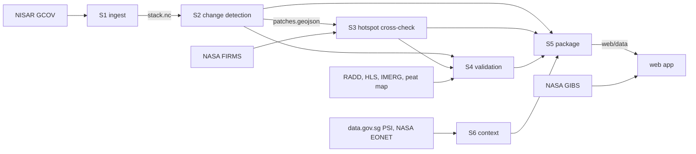

# Blindspot

**What the hotspots missed.** NISAR L-band radar sees land change under the haze of Indonesia's 2026 peatland fire season and audits the satellite hotspot record against it.

**Live app: https://blindspotsg.earth**

NASA Space Apps Challenge 2026 · Singapore · Challenge: [Dancing with the SARs](https://www.spaceappschallenge.org/2026/challenges/dancing-with-the-sars/?tab=details)

> Research prototype using provisional NISAR data. Shows where land changed, not who caused it. Not for legal or enforcement use without verification on the ground.

## The problem

When smoke is thickest, the MODIS and VIIRS fire satellites see least: smoke and cloud hide fires, and peat smoulders below their detection limit. So the hotspot record of what burned is least complete exactly when haze reaches Singapore (24-hr PSI 192 on 9 Oct 2026). NISAR's L-band radar observes through smoke and cloud every 12 days.

## What Blindspot does

1. Detects land change in a 50 × 50 km peat landscape near Sampit, Central Kalimantan, from 11 NISAR GCOV dates (18 Jun to 28 Oct 2026), using a sequential omnibus statistical test on HH and HV backscatter.
2. Checks every change patch against NASA FIRMS VIIRS and MODIS hotspots.
3. Reports the share of radar-detected change with **no hotspot recorded**, with a Monte Carlo range, an error-adjusted area with a 95% confidence interval, and per-patch evidence.
4. Shows it all in an interactive map: timeline, before/after, patch inspector, "why radar" panel and the Singapore haze timeline.

Full brief: [`docs/BRIEF.md`](docs/BRIEF.md).

## Quick start (5 minutes, no logins)

```bash
git clone https://github.com/abd2467/blindspot && cd blindspot
make setup        # python -m pip install -r requirements.txt
make demo         # synthetic data -> full pipeline -> web/data (about 10 s)
make serve        # open http://localhost:8000
```

The red banner means you are looking at **synthetic demo data** (`data/fixtures`). Real data replaces it as each workstream delivers.

Without `make` (Windows): `pip install -r requirements.txt`, `python scripts/run_pipeline.py --fixtures`, `python -m http.server -d web 8000`.

## How the team works

Six people on six machines, each owning one workstream. Workstreams connect only through fixed file formats, so nobody waits for anybody.

| Workstream | Builds | Guide |
|---|---|---|
| WS1 Radar ingest | NISAR GCOV → `stack.nc` | [guide](docs/workstreams/WS1_radar_ingest.md) |
| WS2 Change detection | omnibus test, patches, synthetic burn test | [guide](docs/workstreams/WS2_change_detection.md) |
| WS3 Fire record | FIRMS hotspots, cross-check, headline + Monte Carlo | [guide](docs/workstreams/WS3_fire_record.md) |
| WS4 Validation | RADD, labelled sample, Olofsson CI, patch review, rain, peat | [guide](docs/workstreams/WS4_validation.md) |
| WS5 Web app | the interactive site | [guide](docs/workstreams/WS5_web_app.md) |
| WS6 Story and submission | PSI, EONET, slides or video, References, submit | [guide](docs/workstreams/WS6_story_submission.md) |
| Integration lead | config, contracts, packaging, final run | [team plan](docs/TEAM_PLAN.md) |

- **Start here:** [`docs/TEAM_PLAN.md`](docs/TEAM_PLAN.md) (owners, timeline, gates, git workflow).
- **Exact dataset links and filters (use only these):** [`docs/DATASETS.md`](docs/DATASETS.md).
- **File formats between workstreams:** [`docs/CONTRACTS.md`](docs/CONTRACTS.md).
- **Using an AI assistant?** It reads [`AGENTS.md`](AGENTS.md) (Claude Code via `CLAUDE.md`). For a chat assistant, paste `AGENTS.md` and your workstream guide first.
- **Visual map of the repo and the workflow:** download [`docs/floorplan.html`](docs/floorplan.html) and open it in a browser (GitHub shows it as code). It shows every stage, who owns it, which file it hands to whom, and two guided flows ("From radar image to headline number", "How your work plugs in"). The lead refreshes it after big merges.
- **Your own live map (optional):** [Floorplan](https://github.com/haydenschmitty/floorplan) draws a plain-English, clickable map of this repo inside Claude Code or Codex. Each person installs it on their own machine (Node.js 18+):
  ```bash
  claude plugin marketplace add haydenschmitty/floorplan && claude plugin install floorplan@floorplan   # Claude Code
  codex plugin marketplace add haydenschmitty/floorplan && codex plugin add floorplan@floorplan        # Codex
  ```
  Then ask "Make me a floorplan of this app" (later: "Update the floorplan"). Its `floorplan/` folder stays out of git, so nothing to commit.
- **Code review:** every pull request is reviewed by CodeRabbit (config in `.coderabbit.yaml`) and one teammate.

## Commands

| Command | What it does |
|---|---|
| `make demo` | Build fixtures and run the pipeline on them |
| `make real` | Run S2 → S5 on real data in `data/` |
| `make check` | Tests + contract checks on fixtures |
| `make serve` | Serve `web/` at http://localhost:8000 |
| `python -m blindspot.contracts all` | Check every hand-off file that exists |

## Architecture



## Data and credits

NASA: NISAR GCOV and soil moisture (ASF DAAC), FIRMS active fire (VIIRS, MODIS), EONET, GIBS, GPM IMERG. Also RADD alerts (Wageningen University), Global Peatland Map 2.0 (Greifswald Mire Centre), data.gov.sg PSI. Full list with licences: [`docs/DATA_REGISTER.md`](docs/DATA_REGISTER.md).

Libraries: numpy, scipy, xarray, rasterio, geopandas, shapely, pyproj, earthaccess, h5py, Leaflet, Chart.js, OpenStreetMap tiles.

Method references: Conradsen et al. (2016), Canty et al. (2020), Olofsson et al. (2014). See the brief.

## Licence

Code: MIT (see `LICENSE`). Data keep their own licences (see the data register).
