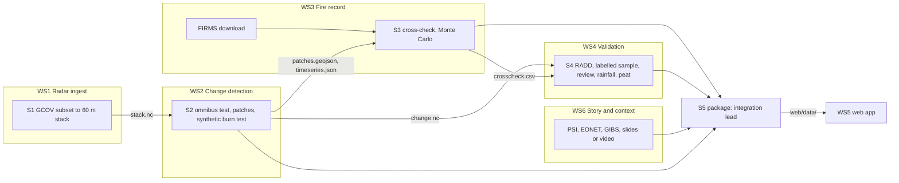

# Blindspot: project brief

**What the hotspots missed.** NASA Space Apps Challenge 2026, Singapore local event (14 to 15 Nov 2026). Challenge: **Dancing with the SARs**, build an interactive app that uses NISAR radar to track and visualise surface change.

> Research prototype using provisional NISAR data. It shows where land changed, not who caused it. Not for legal or enforcement use without verification on the ground.

---

## 1. TL;DR

NISAR's L-band radar sees through smoke and cloud. We use it to map how the land changed in a Central Kalimantan peat landscape during Indonesia's 2026 fire season. Then we check every change against the hotspot record from the MODIS and VIIRS fire satellites, the record Indonesia relies on and the one behind the haze reporting Singapore follows. We report how much of the change that record **did not see**.

- **Study area:** a 50 × 50 km box near Sampit, Central Kalimantan, centred on the 2026 NASA EONET wildfire cluster (about 112.6° E, 2.9° S). NASA's archive holds 11 dual-polarisation NISAR images on one track there, from 18 June to 28 October 2026 (checked in NASA CMR on 14 Nov 2026).
- **Output:** an open-source web app, plus one headline number: *the share of radar-detected land change with no fire hotspot recorded nearby*, with its uncertainty range.
- **System:** statistical radar change detection, cross-checked against NASA fire data, with an uncertainty model and simulation tests.
- **Why now:** Singapore's 24-hour PSI went unhealthy on 4 September 2026 for the first time since October 2023, and peaked at 192 on 9 October.

## 2. Problem statement

During the worst fire seasons, the satellites that track Indonesia's peatland fires go partly blind. Thick smoke and cloud hide fires from MODIS and VIIRS, and peat smoulders underground at temperatures too low to detect. So the official record of what burned is least complete exactly when haze crosses borders. Analysts, journalists and the public have no simple, open way to see how the land changed under the smoke.

**How might we use NISAR's L-band radar, which observes through smoke and cloud every 12 days, to reveal land change during the 2026 fire season that the hotspot record did not capture, and show honestly how sure we are?**

One-line version: *the hotspot record goes quiet exactly when the smoke is worst, and NISAR can show what it missed.*

| Element | Our answer |
|---|---|
| Who is harmed | Residents of Sumatra, Kalimantan, Singapore and Malaysia breathing haze |
| Who uses it | Primary: an environmental or air-quality analyst investigating fire-related land disturbance. Also peat restoration agencies, journalists, the public |
| What is broken | Fire evidence comes from thermal hotspots, which smoke, cloud and smouldering peat hide |
| Where | Peat landscape near Sampit, Central Kalimantan (one NISAR track) |
| When | 2026 fire season, June to October; NISAR dates 18 Jun to 28 Oct |
| Success | A user can see what changed, inspect the evidence for its cause, and see what remains uncertain |

**Testable hypothesis.** Across the study area, a meaningful share of persistent drops in NISAR HV backscatter between June and October 2026 lie more than 1 km from any VIIRS or MODIS hotspot recorded between the previous radar date and the change date. If the share turns out small, that is still a result: it shows where the hotspot record can be trusted.

**Research question (from the team's revised proposal):** where do persistent radar changes coincide with recorded fire activity, and what explains changes without a matched hotspot?

**Scope statement.** Singapore's haze is the motivation. The project examines change on the ground. It does **not** attribute Singapore's haze to individual patches of land, and it does not name land owners.

## 3. Evidence that the problem is real

Each part of the problem statement has a published source, and we confirmed the NISAR data ourselves. The one thing not yet proven is that NISAR reveals change the hotspots missed: that is the hypothesis the app tests.

| Claim | Evidence | Source |
|---|---|---|
| Haze kills | Smoke from the 2015 fires may have caused about 100,000 premature deaths across Indonesia, Malaysia and Singapore | [Harvard SEAS (Koplitz et al., 2016)](https://seas.harvard.edu/news/2016/09/smoke-2015-indonesian-fires-may-have-caused-100000-premature-deaths) |
| Haze is costly | The 2015 fires cost Indonesia US$16.1 billion (about 1.9% of GDP); 2.6 million ha burned | [World Bank, The Cost of Fire](https://openknowledge.worldbank.org/entities/publication/391e19f4-18f7-56c2-8c28-bb89cc9e7d6f) |
| It is happening in 2026 | About 202,004 ha burned in Indonesia by July 2026 | [RRI, 14 Aug 2026](https://rri.co.id/en/environment/2651866/indonesian-government-expands-alert-zone-over-forest-and-land-fire-impacts) |
| Singapore felt it | 24-hr PSI went unhealthy on 4 Sep 2026, the first time since Oct 2023 | [NEA, 4 Sep 2026](https://www.nea.gov.sg/media/news/news/index/singapore-government-agencies-implement-measures-to-mitigate-impact-of-haze-Aug2026) |
| ...badly | PSI peaked at 192 in the central region on 9 Oct 2026; NEA tied the plumes to Sumatra and Kalimantan | [ANN](https://asianews.network/?p=307517), [The Star](https://www.thestar.com.my/aseanplus/aseanplus-news/2026/10/09/haze-in-singapore-psi-hits-173-in-central-region-a-new-high-for-2026) |
| Indonesia relies on hotspots | The government tracks active fires with NASA and NOAA MODIS and VIIRS observations | [NASA Earth Observatory, Sep 2026](https://science.nasa.gov/missions/aqua/peatland-fires-darken-skies-in-indonesia/) |
| Hotspots go quiet in the worst smoke | The recorded fire count can fall when fires are most intense, because thick smoke and cloud block detection | [NASA Earth Observatory, Sep 2026](https://science.nasa.gov/missions/aqua/peatland-fires-darken-skies-in-indonesia/) |
| The gap is large near the equator | Chance of detecting even powerful fires can fall below 30% (MODIS) and 40% (VIIRS) in some equatorial areas, mainly due to cloud | [Sofiev & Kouznetsov, GMD 2026](https://gmd.copernicus.org/articles/19/10123/2026/) |
| Peat hides fire | Peat fires smoulder at low temperatures and often burn underground | [NASA Earth Observatory, Sep 2026](https://science.nasa.gov/missions/aqua/peatland-fires-darken-skies-in-indonesia/) |
| Satellite evidence matters legally | Singapore's Transboundary Haze Pollution Act links a fire to haze using satellite and weather information | [THPA 2014 s. 8](https://lawplayer.com/sg/article/THPA2014/8) |
| L-band radar can see burns in peat | L-band SAR beat C-band for burned-area detection in Indonesian peatland, at 93 to 96% overall accuracy | [Sudiana et al., Computers 2025](https://frontiers.ui.ac.id/synapseai/?p=389) |
| NISAR is built for this | GCOV backscatter is designed to support disturbance detection, biomass and inundation mapping | [NISAR Data User Guide](https://nisar-docs-test.asf.alaska.edu/products-overview) |
| The data exists for our site | 11 dual-pol (HH+HV) GCOV dates on track 061 descending, 18 Jun to 28 Oct 2026; 10 more on ascending track 125 | Our NASA CMR query, 14 Nov 2026 |
| The season reached our site | NASA EONET lists 106 wildfire events in the region from Jun to Nov 2026; 48 fall in a southern Kalimantan box | Our EONET query, 14 Nov 2026 |
| Fire evidence is the bottleneck | By 19 Oct 2026 Singapore had served preventive measure notices to 10 plantation firms; experts say satellite images alone struggle to locate where a fire started, and the law has produced no fines since 2014 | [ANN / The Straits Times, 22 Oct 2026](https://asianews.network/explainer-why-is-it-difficult-to-identify-companies-linked-to-indonesias-forest-fires-and-how-can-singapores-haze-law-be-strengthened/) |

**What this evidence does not prove:** that NISAR will find a large unrecorded share. Some radar change comes from clearing without fire, harvest, flooding or rain. That is why every patch gets two separate labels (section 6), why we validate, and why the result is a range, not a single exact number.

## 4. What the judges want

Judges score five equal criteria from 1 to 5, at the local event and again at global level ([Judging & Awards Guide](https://www.spaceappschallenge.org/resources/judging-awards-guide)). The guide warns that teams often neglect Presentation, so treat it as a full fifth of the score.

| Criterion | What a 5 looks like | How we earn it |
|---|---|---|
| Impact | Significant problem, wide reach | Haze harms millions; Singapore judges lived through it this year |
| Creativity | New approach or meaningful improvement | Not another change map: we audit the hotspot record with radar |
| Validity | Scientifically sound, feasible, close to real-world use | Statistical change test, stated hypothesis, synthetic burn tests, RADD and optical checks, error ranges, a working app |
| Relevance | Answers the challenge; NASA data is core | NISAR GCOV is the engine; NASA FIRMS, EONET, GIBS, GPM IMERG and NISAR soil moisture support it |
| Presentation | Clear, engaging story | Three acts (dry, fire, rain), one headline number, a live demo |

**Submission rules that can disqualify us:**
- Submit before **Sunday 15 November, 23:59 Singapore time**. Click submit on the team's Project tab; a saved draft does not count.
- Demo: at most **7 slides** (title and intro count) or a video of at most **30 seconds**.
- Everything in English.
- At most 6 members, all registered for the Singapore event and on the team page.
- List every external resource (code, images, data) in the References field. `docs/DATA_REGISTER.md` is the source for it.

## 5. Solution

### 5.1 The app

The app plays the 2026 fire season as a 12-day radar timeline and marks which land changes the hotspot record caught and which it did not. The main user journey: **select a patch → see its radar history → see the fire records → review the evidence → read the interpretation and its confidence.**

| Feature | What the user can do |
|---|---|
| Study-area map | See change patches (orange: hotspot recorded; purple: no hotspot recorded; grey: insufficient fire data), FIRMS hotspots for the window, EONET events |
| Timeline | Scrub through the 11 real acquisition dates; the missing early-August date is shown as a gap |
| Before/after | Compare any date with the June baseline using the same display stretch |
| Headline panel | km² of change, % with no hotspot recorded, Monte Carlo range, error-adjusted area with 95% CI |
| Patch inspector | HV and HH history against stable forest, first-change date, hotspot count and distance, flags, confidence tier, interpretation, review notes |
| Why radar | NASA GIBS true colour on a smoky day beside NISAR for the same place |
| Singapore | Daily PSI with the 4 Sep and 9 Oct milestones; rainfall showing the wet season return |
| Method and sources | Rules, parameters, validation results, disclaimer, sources |

### 5.2 Method

The method is grounded in radar physics: L-band HV backscatter comes mostly from volume scattering inside the canopy, so when the canopy dies or burns, HV drops. HH is less sensitive to canopy loss and rises over open water and flooded ground, which helps separate flooding from burning.

1. **Prepare (S1).** Stream only the study-area window of each NISAR GCOV granule (HH and HV, linear power) and average it onto a shared 60 m grid in UTM 49S. Averaging (multilooking) reduces speckle and data size. Mask rivers and lakes.
2. **Normalise (S2).** Divide each date by its scene-median ratio to the reference period, per band. This cancels scene-wide shifts from rain, soil moisture and the late-October processing change. The reference period is the four June and July dates, chosen from the local event timeline; WS2 checks it for early disturbance and drops any affected date.
3. **Detect (S2).** Run the **sequential omnibus test** ([Conradsen et al., 2016](https://www2.imm.dtu.dk/pubdb/pubs/6825-full.html); dual-pol form in [Canty et al., 2020](https://www.mdpi.com/2072-4292/12/1/46)) on HH and HV together. It tests whether a pixel's series is consistent with "no change" and finds the first date of change, at a false-alarm rate we set (1%). The effective number of looks is measured from the reference dates, not assumed. A change counts only if HV decreased and stays at least 1 dB below the reference for 2 consecutive dates. Fallback: HV log-ratio with the threshold at the 1st percentile of reference-period noise.
4. **Make patches (S2).** Group changed pixels (8-connected), drop patches under 1 ha, record first-change date, previous radar date, HV drop, HH change, and flags (`water`, `hh_rise`, `rain`, `calibration`).
5. **Cross-check the hotspot record (S3).** A patch is **hotspot recorded** if any VIIRS or MODIS hotspot (any confidence) lies within 1 km of it and was observed between the previous radar date and the first-change date. Using the actual previous date accounts for gaps such as the missing August acquisition. Otherwise it is **no hotspot recorded**, or **insufficient data** if the fire record has missing days in that window.
6. **Headline (S3).** Share of change area with no hotspot recorded, plus a Monte Carlo range.
7. **Validate and review (S4).** Compare with RADD alerts and optical imagery, label a stratified sample, compute error-adjusted area with a 95% CI, and assign each reviewed patch an interpretation.

### 5.3 Classification and reporting

Each patch gets **two separate labels**, so observation and interpretation never get mixed up:

| Observation comparison (automatic, S3) | Meaning |
|---|---|
| `recorded` | Radar change coincides with a qualifying hotspot under the matching rule |
| `none` | Radar change is present, but no qualifying hotspot was found in the retrieved records and window |
| `insufficient_data` | Missing fire data in the window prevents a reliable comparison |

| Interpretation after review (S4) | Meaning |
|---|---|
| `fire_supported` | Independent evidence (optical burn scar, RADD, hotspots nearby in time) supports fire |
| `other_disturbance` | Evidence supports clearing, harvest or flooding instead |
| `unresolved` | Evidence does not separate the possible causes |
| `not_assessable` | Data limits prevent interpretation (water, edge, missing dates) |
| `unreviewed` | Not yet looked at |

**Wording rule:** say "change with no hotspot recorded", never "missed fire". An unmatched patch is not automatically a missed fire.

The headline reads: **X km² of radar-detected change (error-adjusted Y km², 95% CI a to b); Z% of it had no hotspot recorded (range c to d)**, with the eligible area, excluded area, dates and matching settings stated next to it.

## 6. Uncertainty model

Uncertainty cannot be eliminated, but it can be reduced at each step, measured, and shown. Four layers, one for each place error enters:

| Layer | Where error comes from | How we reduce it | How we measure and show it |
|---|---|---|---|
| 1. Radar noise | Speckle makes pixels flicker between dates | Multilook to 60 m; statistical test at a set false-alarm rate instead of a fixed threshold; 2-date persistence | Per-pixel p-value; false-alarm rate from the synthetic test |
| 2. Environment and processing | Rain, soil moisture, flooding, the late-October processing change | Per-date scene normalisation; HV-led detection; 1 ha minimum patch | Flags for HH rise (water) and calibration; NISAR soil moisture and GPM IMERG rainfall as context |
| 3. The hotspot record | Hotspot positions are approximate; "no hotspot" can mean "no fire" or "fire not seen" | Buffer by sensor footprint; count every confidence level as recorded, which keeps the unrecorded share conservative | `insufficient_data` where fire data is missing; Monte Carlo jitters positions within the footprint |
| 4. The headline number | All of the above add up | Tune on the west half of the area, report on the east half | Confidence tier per patch; error-adjusted area and 95% CI from a labelled sample ([Olofsson et al., 2014](https://doi.org/10.1016/j.rse.2014.02.015)) |

**Confidence tiers.** High: strong, persistent drop (≥ 3 dates, ≤ -3 dB), no flags, and RADD does not disagree. Low: any flag, or change on fewer than 2 dates. Otherwise medium.

**Reference sample.** About 50 points in three strata (change with hotspot, change without hotspot, no change), labelled from Sentinel-2 / HLS and RADD as burn, clearing, flood, no change or unclear. The stratified estimator gives the disturbed area and its 95% CI.

**Optimisation.**
- *Accuracy:* sweep the false-alarm rate, minimum patch size, buffer and time window; pick the setting that best matches RADD on the western half, then report on the eastern half only. RADD is C-band and imperfect: a reference, not ground truth.
- *Speed:* multilooking to 60 m cuts pixel counts 9 to 36 times; stream only the study window; keep everything vectorised (numpy, xarray). The full pipeline reruns in minutes on a laptop.

## 7. Modelling and simulation

Two simulations test the models above, so the headline rests on measured performance.

- **Synthetic burn test (S2).** Inject square burns of 1 to 50 ha with HV drops of 2 to 6 dB into real stable-forest pixels. Multiplying the real intensities keeps the real speckle. Rerun the detector and record the detection rate for each size and drop, plus the false-alarm rate on untouched pixels. The result is a chart of the smallest burn NISAR can reliably detect here, which also sets the minimum patch size.
- **Monte Carlo range (S3).** Rerun the cross-check a few hundred times. Each run jitters hotspot positions within their pixel footprint (VIIRS 375 m, MODIS 1 km) and draws the buffer (0.5 to 2 km) and window slack (0 to 12 days). The 5th to 95th percentile of the unrecorded share is the reported range. Detector sensitivity (false-alarm rate, threshold) is covered by a separate sweep in S2.

Future work, stated as such: physical backscatter modelling of burned peat forest, and smoke-transport modelling (for example NOAA HYSPLIT) linking burn patches to Singapore's PSI. One optional slide: a HYSPLIT back-trajectory from Singapore on 9 October, run in its web tool.

## 8. Data

NASA data does the core work. All sources are free; some need a free login or key.

| Dataset | Role | Access |
|---|---|---|
| NISAR L2 GCOV Provisional `NISAR_L2_GCOV_PROVISIONAL_V1` | **Core.** HH and HV backscatter, 18 Jun to 16 Oct 2026 | Earthdata login. Only `4005_DHDH` (dual-pol) granules; about 5 GB each, so stream a subset |
| NISAR L2 GCOV `NISAR_L2_GCOV_V1` | **Core.** 28 Oct 2026 onward | Newer processing (P05036 vs P05023): check for a calibration jump |
| NISAR L3 Soil Moisture `NISAR_L3_SME2_PROVISIONAL_V1` | Context: how dry the landscape got; rules out rain-driven change | 200 m grid; may be masked under dense forest |
| NISAR DEM and water mask | Mask rivers and lakes | Earthdata login |
| VIIRS 375 m and MODIS active fire (FIRMS) | **The record we audit** | Free MAP_KEY; area API, a few days per call |
| NASA GPM IMERG daily (Late run, `GPM_3IMERGDL`) | Rainfall: tests rain and flooding as explanations | Earthdata login (or Giovanni area-average CSV) |
| NASA EONET wildfire events | Story markers; study-area choice | Open API, no key |
| NASA GIBS true colour | "Optical sees only smoke" panel | Open tile/WMS service |
| Harmonized Landsat Sentinel-2 (HLS) / Sentinel-2 | Optical spot-checks on clear days | Open |
| RADD forest disturbance alerts (WUR) | Independent check (Sentinel-1 based) | Google Earth Engine |
| Global Peatland Map 2.0 (Greifswald Mire Centre) | Context: where the landscape is peat. Peat overlap shows fire on mapped peat, not that peat itself burned | Open GeoTIFF, 1 km |
| Singapore PSI (data.gov.sg) | Human-impact timeline | Open API, one call per day |

Every source, licence and download date goes in `docs/DATA_REGISTER.md`.

## 9. System architecture

The pipeline runs in Python and writes static files; the web app reads them. There is no server, so the demo is fast and hard to break.

| Subsystem | Workstream | Input | Output |
|---|---|---|---|
| S1 Ingest | WS1 Radar ingest | NISAR GCOV granules | `data/interim/stack.nc` |
| S2 Change detection | WS2 Change detection | `stack.nc` | `change.nc`, `patches.geojson`, `timeseries.json`, `synthetic_curve.json` |
| S3 Hotspot cross-check | WS3 Fire record | `patches.geojson`, FIRMS | `hotspots.geojson`, `crosscheck.csv`, `crosscheck_stats.json` |
| S4 Validation and review | WS4 Validation | S2 + S3 outputs, RADD, HLS, IMERG, peat map | `review.csv`, `reference_sample.csv`, `validation_stats.json`, `rain_daily.csv` |
| S5 Package | Integration lead | everything above | `web/data/*` |
| S6 Context | WS6 Story | data.gov.sg, EONET | `psi_daily.csv`, `eonet_events.geojson` |
| Web app | WS5 Web | `web/data/*`, GIBS | the deployed site |

Exact file formats: `docs/CONTRACTS.md`.

## 10. Risks

| Risk | What could go wrong | How we handle it |
|---|---|---|
| Data volume | Each GCOV granule is about 5 GB | Stream only the study window; start downloads in hour one |
| Overclaiming | Some change is clearing, harvest, flooding or noise | Two-label system; "no hotspot recorded" wording; ranges; validation |
| Rain and soil moisture | Wet season from late October shifts backscatter | Scene normalisation; HV-led detection; 2-date persistence; rain flag |
| Calibration jump | 28 Oct comes from a newer processing version | Normalisation; `calibration` flag; drop 28 Oct if a stable area jumps |
| Missing date | No early-August acquisition | Window uses the actual previous date; gap shown in the app |
| Mixed granules | Archive mixes single-pol (SHSH) and dual-pol (DHDH) | Keep `4005_DHDH` only |
| Hotspot location error | VIIRS 375 m, MODIS 1 km pixels | 1 km buffer; Monte Carlo jitter |
| Naming companies | Overlaying concessions invites claims provisional data cannot support | No concession or ownership data at all |
| Indonesian data restrictions | On 16 Oct 2026 Indonesia's Forestry Ministry restricted its mapping platform and threatened charges for unauthorised use of its geospatial data | Use only NASA, Copernicus and other openly licensed global data; record every licence |
| Scope creep | Extra provinces, InSAR or floods leave nothing finished | One track, one area, one number |

**Framing.** The app asks "where did land change without a recorded hotspot?", not "who burned it?". If a judge asks about prosecution: it is a screening tool that shows investigators where to look, including places the hotspot record missed; holding anyone responsible still needs ownership records and checks on the ground by the authorities. We are not lawyers.

## 11. Minimum deliverable and success criteria

Minimum: one real study area, a usable radar comparison, real fire records, a small set of reviewed patches, in the interactive app. Area-wide statistics appear only when coverage and validation support them; otherwise the deliverable is a clearly bounded case study.

Success means a user can see what changed, inspect the evidence for its cause, and see what remains uncertain. The project is useful whether the radar and the hotspot record agree, disagree or give an inconclusive result.

## 12. Sources

- [Dancing with the SARs: challenge details and resources](https://www.spaceappschallenge.org/2026/challenges/dancing-with-the-sars/?tab=details)
- [Space Apps Judging & Awards Guide](https://www.spaceappschallenge.org/resources/judging-awards-guide)
- [Harvard SEAS: 2015 smoke and 100,000 premature deaths](https://seas.harvard.edu/news/2016/09/smoke-2015-indonesian-fires-may-have-caused-100000-premature-deaths)
- [World Bank: The Cost of Fire (2016)](https://openknowledge.worldbank.org/entities/publication/391e19f4-18f7-56c2-8c28-bb89cc9e7d6f)
- [RRI: burned area by July 2026](https://rri.co.id/en/environment/2651866/indonesian-government-expands-alert-zone-over-forest-and-land-fire-impacts)
- [NEA: haze measures, Sep 2026](https://www.nea.gov.sg/media/news/news/index/singapore-government-agencies-implement-measures-to-mitigate-impact-of-haze-Aug2026)
- [Asia News Network: PSI peak of 192 on 9 Oct 2026](https://asianews.network/?p=307517)
- [The Star: PSI hits 2026 high](https://www.thestar.com.my/aseanplus/aseanplus-news/2026/10/09/haze-in-singapore-psi-hits-173-in-central-region-a-new-high-for-2026)
- [NASA Earth Observatory: Peatland fires darken skies in Indonesia (Sep 2026)](https://science.nasa.gov/missions/aqua/peatland-fires-darken-skies-in-indonesia/)
- [Sofiev & Kouznetsov, Geoscientific Model Development (2026)](https://gmd.copernicus.org/articles/19/10123/2026/)
- [Singapore Transboundary Haze Pollution Act 2014, s. 8](https://lawplayer.com/sg/article/THPA2014/8)
- [Sudiana et al.: L-band vs C-band burned-area detection in Indonesia](https://frontiers.ui.ac.id/synapseai/?p=389)
- [NISAR Data User Guide](https://nisar-docs.asf.alaska.edu/) and [products overview](https://nisar-docs-test.asf.alaska.edu/products-overview)
- [NASA CMR: NISAR collections](https://cmr.earthdata.nasa.gov/search/collections.json?keyword=NISAR)
- [NASA FIRMS area API](https://firms.modaps.eosdis.nasa.gov/api/area/)
- [NASA Open APIs (EONET, GIBS)](https://api.nasa.gov/)
- [WUR: RADD forest disturbance alerts](https://www.wur.nl/en/research/products-services/radd-forest-disturbance-alert)
- [Global Peatland Map 2.0 (GEE community catalog page)](https://gee-community-catalog.org/projects/peatland/)
- [ANN / The Straits Times: why it is hard to identify companies behind the fires](https://asianews.network/explainer-why-is-it-difficult-to-identify-companies-linked-to-indonesias-forest-fires-and-how-can-singapores-haze-law-be-strengthened/)
- [data.gov.sg: Historical 24-hr PSI](https://data.gov.sg/datasets/d_b4cf557f8750260d229c49fd768e11ed/view)
- [Conradsen et al. (2016): change points in polarimetric SAR time series](https://www2.imm.dtu.dk/pubdb/pubs/6825-full.html)
- [Canty et al. (2020): sequential omnibus change detection on dual-pol data](https://www.mdpi.com/2072-4292/12/1/46)
- [Olofsson et al. (2014): good practices for estimating area and assessing accuracy of land change](https://doi.org/10.1016/j.rse.2014.02.015)
